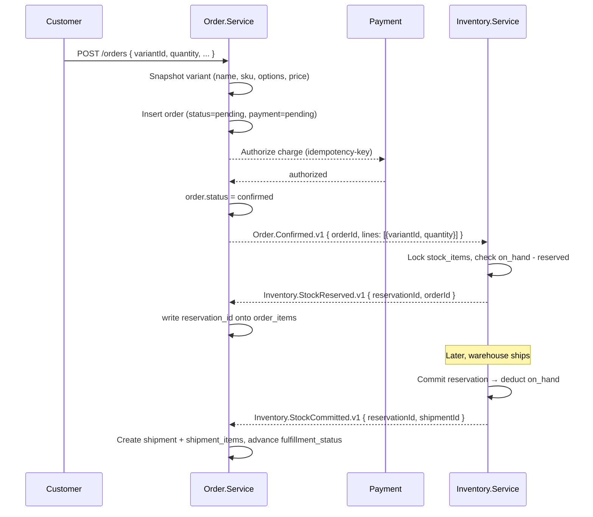

# Order Service — Database Design

**Database:** `orderdb`
**Owner:** `Order.Service`
**Audience:** anyone implementing or reviewing the order aggregate.

## 1. Purpose

The order service is the system of record for the **commercial transaction**
between a customer and the platform. It owns:

- The order aggregate (header, items, addresses, totals).
- The order lifecycle from cart to delivery.
- A link to the payment provider for the money side of the transaction.
- The shipment record once stock is committed.
- The outbox of integration events the rest of the platform consumes.

It does **not** own stock, product catalog, or user identity. It refers to
those services by id and consumes their events.

## 2. Schema overview

```
   orders ──┬── order_items
            ├── order_status_history
            ├── shipping_address  (1:1, jsonb on orders)
            ├── billing_address   (1:1, jsonb on orders)
            ├── payment           (1:1)
            ├── shipments ──── shipment_items
            └── outbox_messages
```

## 3. Tables

### 3.1 `orders`

The aggregate root. The order is a single transaction: one customer, one cart,
one or more shipments, one payment.

| Column | Type | Notes |
| --- | --- | --- |
| `id` | `uuid` PK | `gen_random_uuid()` |
| `customer_id` | `uuid` | the identity service's user id (no FK) |
| `customer_email` | `varchar(256)` | snapshot, in case the user is later deleted |
| `customer_phone` | `varchar(32)` NULL | snapshot |
| `order_status` | `varchar(24)` | state machine below |
| `subtotal` | `numeric(18,4)` | sum of line items before tax |
| `discount_total` | `numeric(18,4)` | negative or zero |
| `tax_total` | `numeric(18,4)` | |
| `shipping_fee` | `numeric(18,4)` | |
| `grand_total` | `numeric(18,4)` | `subtotal + discount_total + tax_total + shipping_fee` |
| `idempotency_key` | `varchar(128)` NULL | from the storefront; for safe retries |
| `placed_at` | `timestamptz` | when the customer confirmed the cart |
| `confirmed_at` | `timestamptz` NULL | when payment authorized and stock reserved |
| `shipped_at` | `timestamptz` NULL | when all shipments left the warehouse |
| `delivered_at` | `timestamptz` NULL | when the last shipment was delivered |
| `cancelled_at` | `timestamptz` NULL | |
| `cancel_reason` | `varchar(128)` NULL | |
| `shipping_address` | `jsonb` | full address, embedded value object |
| `billing_address` | `jsonb` | full address, embedded value object |
| `notes` | `varchar(1024)` NULL | from the customer |
| `channel` | `varchar(16)` | `web`, `admin`, `api` |
| `created_at` | `timestamptz` | |
| `updated_at` | `timestamptz` | |
| `xmin` | `xid` | row version |

Constraints:

- `UNIQUE (order_number)`.
- `UNIQUE (idempotency_key) WHERE idempotency_key IS NOT NULL` — partial index.
- `CHECK (status IN (...))` — see state machine.
- `CHECK (grand_total = subtotal + discount_total + tax_total + shipping_fee)`.
- `CHECK (subtotal >= 0)`.
- `CHECK (tax_total >= 0)`.
- `CHECK (shipping_fee >= 0)`.
- `CHECK (discount_total <= 0)`.

Indexes:

- `IX_orders_customer` on `(customer_id, placed_at DESC)`.
- `IX_orders_status_placed` on `(status, placed_at)` — for the fulfilment queue.
- `IX_orders_number` — covered by the unique constraint.

### 3.2 `order_items`

A line on the order. Each line is one **variant** of one product, at the
price at the time the order was placed. Prices, names, SKUs and the option
map are snapshotted on the line so historical orders remain readable even
if the variant is later deleted, renamed, repriced or its options change.
See [`variants.md`](./variants.md) §4 for the snapshot strategy.

| Column | Type | Notes |
| --- | --- | --- |
| `id` | `uuid` PK | |
| `order_id` | `uuid` FK→`orders.id` ON DELETE CASCADE | |
| `product_id` | `uuid` | catalog's product id (no FK) |
| `variant_id` | `uuid` | catalog's variant id (no FK) — **replaces the bare `sku` column** |
| `product_name` | `varchar(256)` | **snapshot** of the product name |
| `quantity` | `numeric(18,4)` | |
| `unit_price` | `numeric(18,4)` | **snapshot** of the variant's price at order time |
| `line_discount` | `numeric(18,4)` | line-level discount, ≤ 0 |
| `line_total` | `numeric(18,4)` | `(unit_price * quantity) + line_discount` |
| `reservation_id` | `uuid` NULL | the inventory service's reservation id, once reserved |

Constraints:

- `CHECK (quantity > 0)`.
- `CHECK (fulfillment_status IN ('pending','partially_shipped','shipped','delivered','cancelled','returned'))`.

Indexes:

- `IX_order_items_order` on `(order_id)`.
- `IX_order_items_variant` on `(variant_id)`.
- `IX_order_items_product` on `(product_id)` — for "all items for product X" reports.

**What we no longer keep:** the original design had a flat `sku varchar(64)`
column. That column is replaced by `variant_id` (the canonical reference)
plus `variant_sku` (the denormalized text snapshot for printing). This avoids
the case where a customer sees the wrong SKU on an old order because the
catalog's SKU was edited.

Indexes:

- `IX_order_status_history_order_time` on `(order_id, occurred_at)`.

### 3.4 `payments`

One payment per order. If a payment fails and a new one is taken, the old row
is marked `void` and a new row is created — payment history is preserved.

| Column | Type | Notes |
| --- | --- | --- |
| `id` | `uuid` PK | |
| `order_id` | `uuid` FK→`orders.id` ON DELETE CASCADE | unique — one payment per order |
| `provider` | `varchar(32)` | `stripe`, `vnpay`, `momo`, `cod`, `bank_transfer` |
| `status` | `varchar(16)` | `pending`, `authorized`, `captured`, `failed`, `void`, `refunded` |
| `amount` | `numeric(18,4)` | |
| `currency` | `char(3)` | |
| `provider_charge_id` | `varchar(128)` NULL | the provider's id for the charge |
| `idempotency_key` | `varchar(128)` NULL | |
| `authorized_at` | `timestamptz` NULL | |
| `captured_at` | `timestamptz` NULL | |
| `failed_at` | `timestamptz` NULL | |
| `failure_reason` | `varchar(256)` NULL | |
| `created_at` | `timestamptz` | |
| `updated_at` | `timestamptz` | |

Constraints:

- `UNIQUE (order_id)` — exactly one current payment per order.
- `CHECK (status IN ('pending','authorized','captured','failed','void','refunded'))`.

### 3.5 `shipments`

An order can have one or more shipments — partial fulfilment (some items
ship now, the rest later) is the main reason; splitting across warehouses is
not a reason, since the platform ships from a single warehouse. Each shipment
is handed to a carrier and becomes a tracking number.

| Column | Type | Notes |
| --- | --- | --- |
| `id` | `uuid` PK | |
| `order_id` | `uuid` FK→`orders.id` ON DELETE CASCADE | |
| `status` | `varchar(16)` | `pending`, `picking`, `packed`, `shipped`, `in_transit`, `delivered`, `failed`, `returned` |
| `carrier` | `varchar(32)` NULL | `ghn`, `ghtk`, `vnpost`, `dhl`, ... |
| `shipped_at` | `timestamptz` NULL | |
| `delivered_at` | `timestamptz` NULL | |
| `shipping_fee` | `numeric(18,4)` | portion of the order's shipping fee |
| `created_at` | `timestamptz` | |
| `updated_at` | `timestamptz` | |

Constraints:

- `CHECK (status IN (...))`.
- `UNIQUE (shipment_number)`.
- `UNIQUE (carrier, tracking_number) WHERE tracking_number IS NOT NULL`.

Indexes:

- `IX_shipments_order` on `(order_id)`.
- `IX_shipments_status` on `(status)`.


Constraints:

- `CHECK (quantity > 0)`.

Indexes:

- `IX_shipment_items_order_item` on `(order_item_id)`.

### 3.7 `outbox_messages`

Owned by this service. Same shape as in every service — provided by the
building block.

| Column | Type | Notes |
| --- | --- | --- |
| `id` | `uuid` PK | |
| `message_type` | `varchar(256)` | full CLR type name |
| `payload` | `jsonb` | the serialized event |
| `headers` | `jsonb` | trace context, message id, causation id |
| `created_at` | `timestamptz` | |
| `published_at` | `timestamptz` NULL | set when the broker has acked |
| `attempts` | `int` | |
| `next_attempt_at` | `timestamptz` | |

Indexes:

- `IX_outbox_unpublished` on `(next_attempt_at) WHERE published_at IS NULL`.

### 3.8 `processed_messages`

Idempotency for inbound events. Same shape across services.

| Column | Type | Notes |
| --- | --- | --- |
| `event_id` | `uuid` PK | from the `EventId` header |
| `consumer` | `varchar(128)` | the consumer that processed it |
| `processed_at` | `timestamptz` | |

## 4. State machine

### 4.1 Order status

```
                 ┌──────────────────────────────────────────┐
                 │                                          │
                 ▼                                          │
              pending ──payment fail──► failed              │
                 │                                          │
                 │ payment authorized + stock reserved      │
                 ▼                                          │
             confirmed ──────────────────► cancelled        │
                 │                                          │
                 │ first shipment leaves                    │
                 ▼                                          │
        partially_shipped                                  │
                 │                                          │
                 │ last shipment leaves                     │
                 ▼                                          │
              shipped ────all delivered──► delivered        │
                 │                                          │
                 │ return window closed                     │
                 ▼                                          │
             completed                                     │
                 │                                          │
                 └───────► cancelled (only from pending/confirmed)
```

Allowed transitions:

| From | To | Trigger |
| --- | --- | --- |
| `pending` | `confirmed` | payment authorized + stock reserved |
| `pending` | `failed` | payment or reservation failed |
| `pending` | `cancelled` | customer or admin cancelled |
| `confirmed` | `partially_shipped` | first shipment shipped, more remain |
| `confirmed` | `shipped` | all items shipped in one go |
| `partially_shipped` | `shipped` | last shipment shipped |
| `shipped` | `delivered` | all shipments delivered |
| `delivered` | `completed` | return window closed (cron) |
| `pending` or `confirmed` | `cancelled` | explicit cancellation; triggers stock release |

### 4.2 Payment status

```
pending ─► authorized ─► captured ─► refunded
   │            │             ▲
   │            │             │
   ▼            ▼             │
 failed       void ───────────┘
```

## 5. Cross-service flow (the saga)

The order service does not call inventory synchronously. It publishes an
event, inventory reacts, and publishes back. This is a saga, not 2PC.



Failure handling:

- If `OrderConfirmed` is published but `StockReserved` never arrives, the
  `Order.Service` background job looks for orders in `confirmed` for more
  than N minutes and asks inventory for the reservation status.
- If `OrderCancelled` is published, `Inventory.Service` releases any active
  reservations. The order waits for `StockReleased` before going to
  `cancelled`.

**Variant handling in the saga.** When the order is placed, the order
service looks up the variant (sync call to `ProductCatalog` or cached
projection) and writes `product_id`, `variant_id`, `product_name`,
`variant_name`, `variant_sku`, `variant_options_snapshot` and
`unit_price` onto the `order_items` row in the same transaction. Every
event the order publishes (`Order.Placed`, `Order.Confirmed`, etc.)
carries that snapshot in the payload, so consumers do not have to call
back to the catalog to render the order.

## 6. Events produced

| Event | When | Payload |
| --- | --- | --- |
| `Order.Placed.v1` | order row inserted | `orderId`, `customerId`, `lines[]` (each: `productId`, `variantId`, `sku`, `productName`, `variantName`, `options`, `quantity`, `unitPrice`) |
| `Order.Confirmed.v1` | payment authorized | `orderId`, `lines[]`, `paymentId` |
| `Order.Cancelled.v1` | cancellation requested | `orderId`, `reason` |
| `Order.Failed.v1` | payment or reservation failed | `orderId`, `reason` |
| `Order.Shipped.v1` | first shipment leaves | `orderId`, `shipmentId`, `lines[]` |
| `Order.Delivered.v1` | last shipment delivered | `orderId` |
| `Order.Completed.v1` | return window closed | `orderId` |

Every published event that references a product carries the same snapshot
the order line carries (`productId`, `variantId`, `sku`, `productName`,
`variantName`, `options`) so consumers do not need to call back to the
catalog to render the event.

## 7. Events consumed

| Event | Source | Effect |
| --- | --- | --- |
| `Inventory.StockReserved.v1` | Inventory | link `reservation_id` to each `order_item`; advance state |
| `Inventory.StockReservationFailed.v1` | Inventory | mark order `failed`; record `failure_reason` |
| `Inventory.StockCommitted.v1` | Inventory | create `shipment` + `shipment_items`; advance state |
| `Inventory.StockReleased.v1` | Inventory | if a cancellation is in flight, finish it |
| `ProductVariant.PriceChanged.v1` | ProductCatalog | update `order_items.unit_price` only for orders still in `pending`; if a line item in a pending order becomes unavailable or out of price range, surface a warning to the customer |
| `ProductVariant.Upserted.v1` | ProductCatalog | refresh the local variant cache used for snapshotting |
| `ProductVariant.Deleted.v1` | ProductCatalog | invalidate cached variants; do **not** alter historical `order_items` |

## 8. Idempotency

Three layers:

1. **Inbound from the gateway** — `orders.idempotency_key` with a unique
   partial index. A retry of the same `POST /orders` returns the existing
   order, not a duplicate.
2. **Outbound to the payment provider** — `payments.idempotency_key`. The
   same key on retry returns the same charge.
3. **Inbound from the message bus** — `processed_messages` table. Every
   consumer checks before applying the event.

## 9. Connection string

```
Host=127.0.0.1;Port=5432;Database=orderdb;Username=postgres;Password=...
```

## 10. Open questions

1. **Returns and refunds.** `order_items.fulfillment_status` has a `returned`
   value, but a `returns` table is not designed. For a first cut, returns
   can be modeled as a new order with negative line items — but a real
   returns workflow should have its own table.
2. **Multi-currency.** The current design assumes the order is in one
   currency. If cross-currency is required, FX rate snapshots belong on
   `order_items`.
3. **Tax.** Tax is snapshotted per line. If the tax engine is to be
   authoritative, `order_items.tax_*` columns should be nullable and a
   `tax_jurisdiction` reference added. For a first cut, the storefront
   computes tax and stores it.
